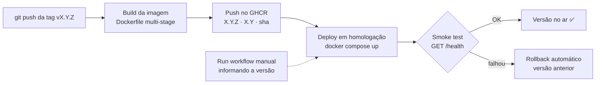

# API Controle Financeiro

API REST para gerenciar receitas e despesas, feita em **FastAPI + SQLAlchemy + PostgreSQL**, com CI/CD no GitHub Actions e imagens publicadas no GitHub Container Registry (GHCR).

Projeto da disciplina **Integração DevOps** (ADS · CEUB).

## Endpoints

| Método | Rota | Descrição |
|---|---|---|
| GET | `/health` | Health check (usado pelo smoke test e pelo `HEALTHCHECK` do Docker) |
| POST | `/movimentacoes/` | Cria uma receita ou despesa |
| GET | `/movimentacoes/` | Lista as movimentações |
| PUT | `/movimentacoes/{id}` | Atualiza uma movimentação |
| DELETE | `/movimentacoes/{id}` | Exclui uma movimentação |
| GET | `/movimentacoes/saldo` | Total de receitas, despesas e saldo |
| GET | `/movimentacoes/resumo` | Resumo financeiro |

Documentação interativa (Swagger): http://localhost:8000/docs

## Como rodar localmente com Docker Compose

Pré-requisito: Docker Desktop (ou Docker Engine + plugin Compose).

1. Crie o arquivo `.env` a partir do exemplo e troque a senha:

   ```powershell
   # Windows (PowerShell)
   Copy-Item .env.example .env
   ```

   ```bash
   # Linux / macOS
   cp .env.example .env
   ```

   Use só letras e números em `POSTGRES_PASSWORD`, porque ela entra na `DATABASE_URL`.

2. Suba a API e o PostgreSQL:

   ```bash
   docker compose up --build
   ```

   Depois da primeira vez, `docker compose up` basta.

3. Teste:

   ```bash
   curl http://localhost:8000/health
   # {"status":"ok"}
   ```

4. Para parar: `docker compose down` (adicione `-v` para apagar também o volume do banco).

Serviços do `docker-compose.yml`:

- **db**: `postgres:16-alpine`, com volume `pgdata` e healthcheck `pg_isready`;
- **api**: imagem construída pelo `Dockerfile` (multi-stage, usuário não-root, `HEALTHCHECK` no `/health`), que só sobe depois que o banco está saudável.

### Rodar os testes sem Docker

```bash
pip install -r requirements.txt
pytest
```

Os testes usam SQLite (`test_financeiro.db`), então não precisam do PostgreSQL.

## Pipeline de CI/CD

| Workflow | Quando roda | O que faz |
|---|---|---|
| `ci.yml` | push na `main` / `feature/**` e PRs para `main` | Instala dependências, roda `pytest` e testa o `docker build` |
| `cd.yml` | push de tag `vX.Y.Z` ou execução manual | Build, push no GHCR, deploy em homologação, smoke test e rollback |

### Fluxo de CD



Versão em texto: `tag → build → push no GHCR → deploy → smoke test → (falhou?) rollback`

O workflow está dividido em jobs separados (`publish` e `deploy-homologacao`) para facilitar a inclusão de SAST, Trivy e monitoramento na A3.

> **A homologação é simulada.** O "ambiente de homologação" é o próprio runner do GitHub Actions (`ubuntu-latest`): a API e o PostgreSQL sobem com `docker compose` dentro do job, o smoke test roda contra `localhost:8000` e tudo é descartado no fim da execução. Não há servidor externo.

Detalhes sobre versionamento, rollback automático, rollback manual e as evidências estão em **[docs/ROLLBACK.md](docs/ROLLBACK.md)**.

## Gestão de segredos

- **Nenhuma senha fica no código.** O `docker-compose.yml` só referencia variáveis (`${POSTGRES_USER}`, `${POSTGRES_PASSWORD}`, `${POSTGRES_DB}`).
- **Local:** os valores ficam no arquivo `.env`, que não vai para o repositório. O `.env.example` traz só valores de exemplo.
- **Homologação:** os valores ficam em **GitHub Secrets** no **Environment `homologacao`** (Settings → Environments → homologacao → Environment secrets):

  | Secret | Uso |
  |---|---|
  | `POSTGRES_USER` | Usuário do PostgreSQL de homologação |
  | `POSTGRES_PASSWORD` | Senha do PostgreSQL de homologação (gerada com `openssl rand -hex 16`) |
  | `POSTGRES_DB` | Nome do banco de homologação |

- O job `deploy-homologacao` declara `environment: homologacao`, então só ele recebe esses secrets. O GitHub mascara os valores nos logs (`***`).
- As credenciais de homologação são **diferentes** das usadas localmente.
- O acesso ao GHCR usa o `GITHUB_TOKEN` automático do Actions, com permissões mínimas: `packages: write` só no job `publish` e `packages: read` no job de deploy.

## Estrutura

```
.
├── app/                    # código da API (FastAPI)
├── tests/                  # testes com pytest
├── docs/ROLLBACK.md        # versionamento, rollback e evidências
├── Dockerfile              # multi-stage, não-root, healthcheck
├── docker-compose.yml      # API + PostgreSQL
└── .github/workflows/
    ├── ci.yml
    └── cd.yml
```
