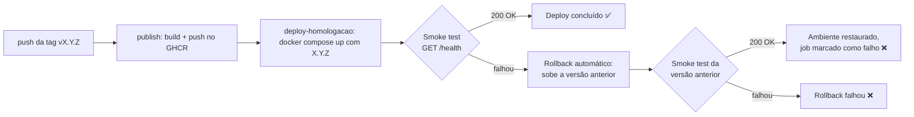
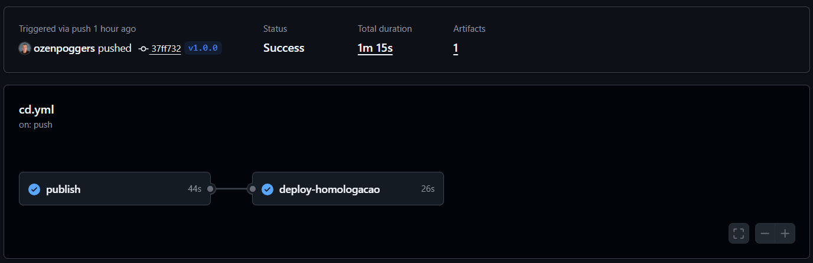
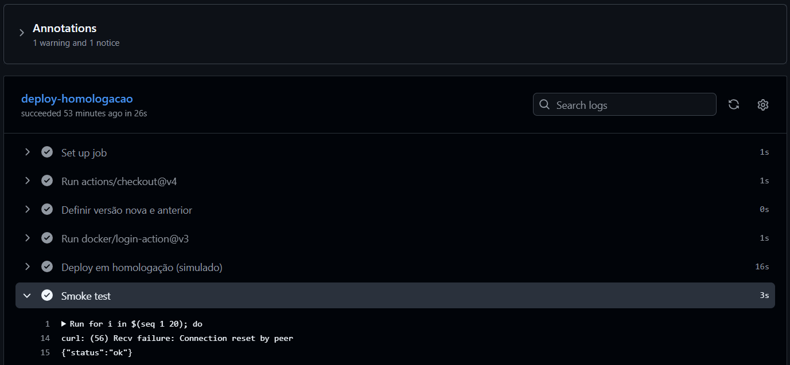
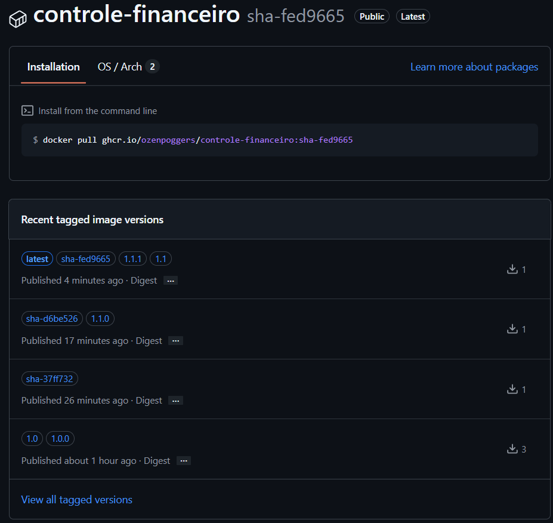
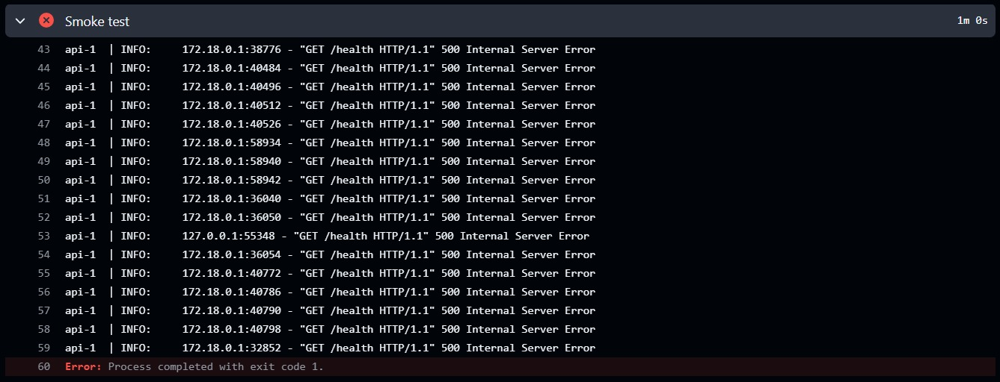
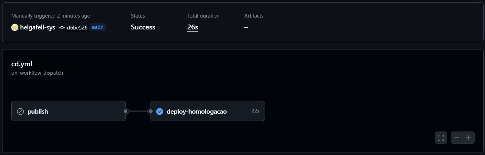
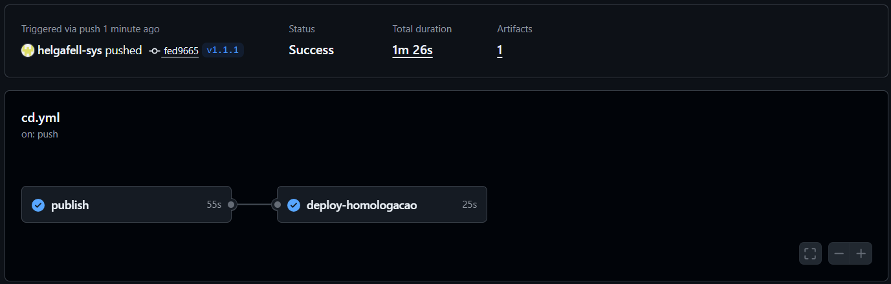

# Versionamento e Rollback

Este documento descreve como as versões da API **Controle Financeiro** são geradas, publicadas e revertidas pelo pipeline de CD (`.github/workflows/cd.yml`).

> **Importante:** o ambiente de **homologação é simulado**. Ele roda dentro do próprio runner do GitHub Actions (`ubuntu-latest`), subindo a API e o PostgreSQL com `docker compose`. Cada execução do workflow cria o ambiente do zero e ele é descartado ao final do job. Não existe servidor de homologação permanente.

---

## 1. Estratégia de versionamento

Usamos **Versionamento Semântico (SemVer)** no formato `MAJOR.MINOR.PATCH`:

| Parte | Quando incrementar | Exemplo |
|---|---|---|
| MAJOR | Mudança incompatível na API (quebra contrato) | `1.0.0` → `2.0.0` |
| MINOR | Funcionalidade nova compatível | `1.0.0` → `1.1.0` |
| PATCH | Correção de bug compatível | `1.1.0` → `1.1.1` |

### Tags no Git

Uma versão é criada com uma tag anotada no formato **`vX.Y.Z`** na `main`:

```bash
git tag v1.1.1
git push origin v1.1.1
```

O push de uma tag que casa com `v*.*.*` dispara o workflow **CD**.

### Tags da imagem no GHCR

O job `publish` usa o `docker/metadata-action` para gerar várias tags para a **mesma imagem** em `ghcr.io/ozenpoggers/controle-financeiro`:

| Tag da imagem | Origem | Exemplo para `v1.1.1` | Para que serve |
|---|---|---|---|
| `X.Y.Z` | `type=semver,pattern={{version}}` | `1.1.1` | Versão exata e imutável. É a usada no deploy e no rollback. |
| `X.Y` | `type=semver,pattern={{major}}.{{minor}}` | `1.1` | Sempre aponta para o último patch da linha `1.1`. |
| `sha-<commit>` | `type=sha` | `sha-a1b2c3d` | Rastreia a imagem até o commit exato que a gerou. |
| `latest` | padrão do metadata-action para tags semver | `latest` | Última versão publicada. Não é usada no deploy. |

Observação: o deploy e o rollback **sempre usam a tag exata `X.Y.Z`**, nunca `latest` ou `X.Y`, para que fique claro qual versão está rodando.

### Versões geradas neste projeto

| Tag | Situação | Resultado no CD |
|---|---|---|
| `v1.0.0` | Primeira versão estável | Deploy + smoke test OK |
| `v1.1.0` | Versão quebrada **de propósito** (`/health` retorna 500) | Smoke test falhou → rollback automático para `1.0.0` |
| `v1.1.1` | Correção do `/health` | Deploy + smoke test OK |

> **Nota de QA sobre a v1.1.0:** o teste `test_health` já pegaria o bug no CI. Para a simulação chegar até a homologação, a v1.1.0 marcou esse teste com `@pytest.mark.xfail(strict=True)`, deixando explícito no código que a falha era esperada. Com `strict=True`, se alguém corrigisse o `/health` e esquecesse o marcador, o CI ficaria vermelho. Na v1.1.1 o marcador foi removido junto com a correção. Num cenário real, o CI barraria essa versão antes do deploy, e o rollback cobre falhas que só aparecem no ambiente (banco, variáveis, rede).

---

## 2. Fluxo de rollback

### 2.1 Rollback automático

Acontece dentro do job `deploy-homologacao`, sempre que um deploy novo falha.



Passo a passo:

1. O passo **"Definir versão nova e anterior"** calcula:
   - `new`: a versão sendo implantada (ex.: `1.1.0`);
   - `prev`: a maior tag `v*` que existe no repositório, sem contar a nova (ex.: `1.0.0`), usando `git tag --sort=-v:refname`.
2. **"Deploy em homologação"** baixa a imagem `ghcr.io/...:new` e sobe com `docker compose up -d --no-build`.
3. **"Smoke test"** chama `GET http://localhost:8000/health` até 20 vezes, com 3 s de intervalo (cerca de 60 s). Se nenhuma chamada retornar 2xx, mostra `docker compose logs api` e falha.
4. **"Rollback automático"** só roda se algum passo anterior falhou (`if: failure()`) e se existir uma versão anterior. Ele troca `TAG` para `prev`, faz `docker compose pull api` + `up -d` e repete o smoke test.
5. O job termina **vermelho** mesmo quando o rollback dá certo. Isso é intencional: a versão nova **não** foi implantada, e o time precisa ver isso na aba Actions.

### 2.2 Rollback manual

Serve para voltar a qualquer versão já publicada, sem gerar build novo.

1. Abrir **Actions → CD → Run workflow**.
2. Manter a branch `main` e informar a versão no campo **tag** (ex.: `1.0.0`, sem o `v`).
3. Clicar em **Run workflow**.

O que acontece:

- O job `publish` é **pulado** (`if: github.event_name == 'push'`), porque a imagem `1.0.0` já existe no GHCR.
- O job `deploy-homologacao` roda com `new = 1.0.0`, baixa essa imagem e executa o smoke test normalmente.

### 2.3 Limitação conhecida

O rollback automático volta para a **tag imediatamente anterior em ordem SemVer**, sem saber se ela estava saudável. Exemplo: se a `v1.1.1` tivesse falhado, o rollback iria para a `v1.1.0`, que sabemos estar quebrada. Nesse caso o rollback também falharia, e o caminho seria o rollback manual informando `1.0.0`.

Melhoria possível para a A3: registrar a última versão que passou no smoke test (por exemplo, numa tag Git `homologacao-ok` ou num artefato) e usar essa versão como alvo do rollback.

---

## 3. Evidências (Etapa 4)

> Horários em **America/Sao_Paulo (UTC-3)**. Os links levam às execuções em
> https://github.com/ozenpoggers/controle-financeiro/actions/workflows/cd.yml

### 3.1 Versão estável `v1.0.0`

**Execução:** [CD #1 · v1.0.0](https://github.com/ozenpoggers/controle-financeiro/actions/runs/41960349704) · 05/11/2026 00:14



Pipeline completo da primeira versão: `publish` construiu e publicou a imagem, e `deploy-homologacao` terminou verde.



Log do job de deploy com o smoke test recebendo `{"status":"ok"}` do `/health`. A primeira tentativa dá `Connection reset by peer` porque a API ainda estava subindo, e o laço de 20 tentativas existe justamente para tolerar esse tempo de inicialização.



Pacote `controle-financeiro` no GHCR, capturado depois da v1.1.1. Mostra a estratégia de tags na prática:

- `1.0.0` e `1.0` continuam disponíveis, e é deles que o rollback puxa a imagem;
- `1.1.0` aponta para a imagem quebrada (`sha-d6be526`);
- `1.1.1`, `1.1` e `latest` apontam para a correção (`sha-fed9665`). A tag `1.1` "andou" de `1.1.0` para `1.1.1`, como esperado para `X.Y`;
- `sha-37ff732` aparece separado porque a tentativa errada da v1.1.0 (ver registro de incidente abaixo) reconstruiu o mesmo commit e moveu essa tag para a nova imagem.

### 3.2 Versão quebrada `v1.1.0` e rollback automático

> **Registro de incidente:** a primeira tentativa da v1.1.0 (CD #2, 00:42) foi criada **antes** do merge do PR da versão quebrada. A tag apontou para o mesmo commit da v1.0.0, e o deploy passou porque publicou o código antigo. A tag foi apagada (`git push origin --delete v1.1.0`) e recriada depois do merge, gerando a execução CD #3. Lição: conferir com `git log --oneline -1` que a `main` local contém o merge antes de criar a tag.

**Execução:** [CD #3 · v1.1.0](https://github.com/ozenpoggers/controle-financeiro/actions/runs/41964114151) · 05/11/2026 00:50



O `/health` da v1.1.0 retorna HTTP 500 de propósito. O `curl -f` falha nas 20 tentativas (cerca de 1 minuto), o passo imprime o `docker compose logs api`, que mostra cada `GET /health` respondido com `500 Internal ServerO passo **"Rollback automático"** começa com a mensagem `Falha na versão 1.1.0. Voltando para 1.0.0`, baixa a imagem `1.0.0` do GHCR, recria só o container da API (o banco continua rodando) e repete o smoke test, que responde `{"status":"ok"}`. O job fica vermelho porque a versão nova não foi implantada.1.0.0` e o smoke test volta a responder `{"status":"ok"}`. O job fica vermelho porque a versão nova não foi implantada.

### 3.3 Rollback manual para `1.0.0`

**Execução:** [CD #4 · manual 1.0.0](https://github.com/ozenpoggers/controle-financeiro/actions/runs/41964718688) · 05/11/2026 00:56



Execução disparada em **Actions → CD → Run workflow** com `tag = 1.0.0`. O job `publish` aparece como pulado e o `deploy-homologacao` sobe a imagem `1.0.0` existente, com smoke test verde.

### 3.4 Correção `v1.1.1`

**Execução:** [CD #5 · v1.1.1](https://github.com/ozenpoggers/controle-financeiro/actions/runs/41965446342) · 05/11/2026 01:04



Com o `/health` corrigido, a v1.1.1 passa no smoke test, sem rollback. A tag `1.1` no GHCR passa a apontar para `1.1.1`.
